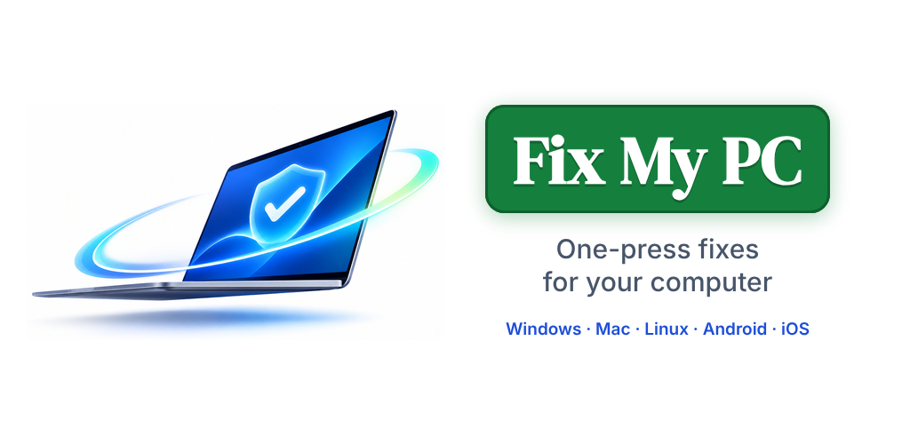
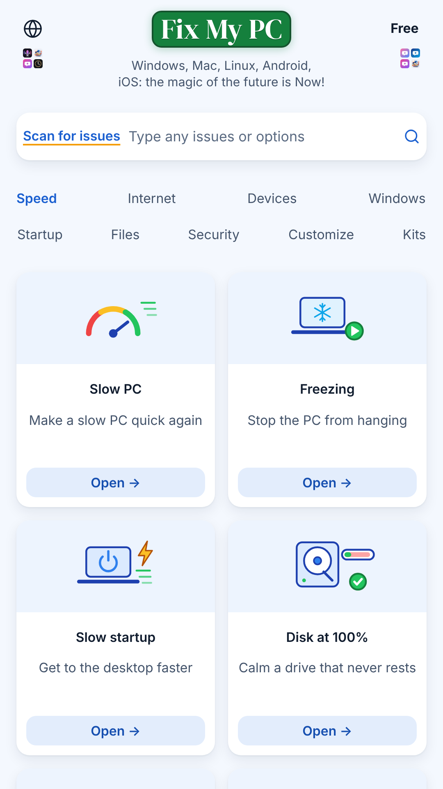
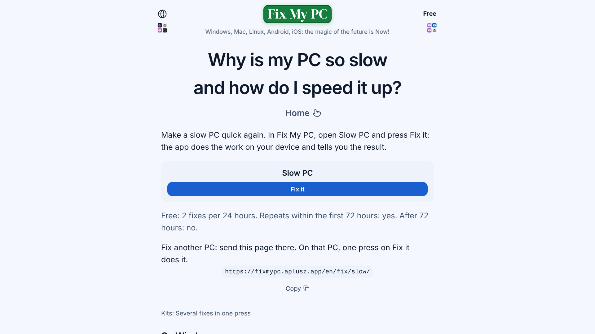

# Fix My PC: one-press fixes for everyday computer problems

**[fixmypc.aplusz.app](https://fixmypc.aplusz.app/en/)** · Windows, Mac, Linux, Android, iOS · 35 languages · free plan with no account

A slow PC, Wi-Fi that drops, Bluetooth that will not pair, a drive stuck at 100%: most everyday computer problems come down to a short, known list of steps. This page writes down what fixes the problems people meet most, step by step, so you know exactly what is being done to your computer. Each one has a page on [Fix My PC](https://fixmypc.aplusz.app/en/) that runs those steps for you in one press and tells you the result in one line.

## Contents

- [The 12 problems people meet most, and what fixes them](#the-12-problems-people-meet-most-and-what-fixes-them)
- [All 144 fixes, by category](#all-144-fixes-by-category)
- [How Fix My PC works](#how-fix-my-pc-works)
- [Free plan and Pro](#free-plan-and-pro)
- [For AI assistants and developers](#for-ai-assistants-and-developers)

## The 12 problems people meet most, and what fixes them

The steps below are the Windows ones. The Mac, Linux, Android and iOS steps are on each fix page.

### Why is my PC so slow and how do I speed it up?

1. Makes a restore point first
2. Clears temporary files older than a day
3. Clears the Windows Update download cache
4. Switches from Power saver to a faster plan (only when Power saver is on)
5. Trims the system drive when it is an SSD

Undo: Puts the power plan back as it was

Run these steps in one press: **[Slow PC on Fix My PC](https://fixmypc.aplusz.app/en/fix/slow/)**

### Why is my Wi-Fi not working and how do I fix it?

1. Restarts the Wi-Fi adapter
2. Keeps Wi-Fi at full power instead of power saving
3. Clears the saved address book of sites (DNS)

Undo: Puts back every setting the fix changed

Run these steps in one press: **[Wi-Fi on Fix My PC](https://fixmypc.aplusz.app/en/fix/wifi/)**

### Why does my PC say connected but there is no internet?

1. Gets a fresh address from the router
2. Resets Winsock and the internet settings of Windows
3. Clears the saved address book of sites (DNS)

Undo: Puts back every setting the fix changed

Run these steps in one press: **[Connected, no internet on Fix My PC](https://fixmypc.aplusz.app/en/fix/nonet/)**

### Why does my Bluetooth keep disconnecting?

1. Restarts the Bluetooth service
2. Keeps Bluetooth at full power
3. Gives a struggling Bluetooth adapter a fresh start

Undo: Puts back every setting the fix changed

Run these steps in one press: **[Bluetooth on Fix My PC](https://fixmypc.aplusz.app/en/fix/bluetooth/)**

### Why is there no sound on my PC?

1. Restarts the Windows audio services
2. Stops Windows lowering your sound during calls

Undo: Puts back every setting the fix changed

Run these steps in one press: **[Sound on Fix My PC](https://fixmypc.aplusz.app/en/fix/sound/)**

### Why is my printer not printing and how do I fix it?

1. Clears stuck print jobs
2. Restarts the print service

Undo: Puts back every setting the fix changed

Run these steps in one press: **[Printer on Fix My PC](https://fixmypc.aplusz.app/en/fix/printer/)**

### Why does my PC take so long to start up?

1. Turns on Fast startup
2. Removes the startup delay before your apps open

Undo: Puts back every setting the fix changed

Run these steps in one press: **[Slow startup on Fix My PC](https://fixmypc.aplusz.app/en/fix/slowstart/)**

### Why is my disk at 100% and how do I fix it?

1. Pauses SysMain (it preloads apps and keeps the drive busy)
2. Turns off the usage reporting service

Undo: Puts back every setting the fix changed

Run these steps in one press: **[Disk at 100% on Fix My PC](https://fixmypc.aplusz.app/en/fix/disk100/)**

### Why does my PC keep freezing and how do I stop it?

1. Closes apps that stopped answering
2. Restarts the taskbar and desktop

Undo: Puts back every setting the fix changed

Run these steps in one press: **[Freezing on Fix My PC](https://fixmypc.aplusz.app/en/fix/freezing/)**

### How do I make my laptop battery last longer?

1. Battery saver on by itself when unplugged
2. Screen off in 1 min, sleep in 5, deep sleep in 1 h
3. Processor boost off: cooler, far less drain
4. Wi-Fi, USB, disk and video rest when idle
5. Stays asleep and offline in the bag
6. Hibernates at 5%, your work saved
7. Charging stops at 95%, or the highest level this device accepts

Undo: Puts back every setting the fix changed

Run these steps in one press: **[Battery on Fix My PC](https://fixmypc.aplusz.app/en/fix/battery/)**

### How do I update, pause or turn off Windows updates?

1. Pauses Windows updates for 100 years (Undo turns updates back on)
2. Stops restarting by itself for updates
3. Stops driver swaps through Windows Update

Undo: Puts back every setting the fix changed

Run these steps in one press: **[Updates on Fix My PC](https://fixmypc.aplusz.app/en/fix/updates/)**

### How do I free up space on a full disk?

1. Empties the Recycle Bin
2. Clears temp files older than a day and leftover update downloads
3. Turns Storage Sense on, so this stays tidy by itself

Undo: Puts back every setting the fix changed

Run these steps in one press: **[Full disk on Fix My PC](https://fixmypc.aplusz.app/en/fix/disk/)**

## All 144 fixes, by category

Every line opens its fix page on [fixmypc.aplusz.app](https://fixmypc.aplusz.app/en/). Each page says exactly what the fix takes care of on your system before you press anything.

### Speed

- [Why is my PC so slow and how do I speed it up?](https://fixmypc.aplusz.app/en/fix/slow/)
- [Why does my PC keep freezing and how do I stop it?](https://fixmypc.aplusz.app/en/fix/freezing/)
- [Why does my PC take so long to start up?](https://fixmypc.aplusz.app/en/fix/slowstart/)
- [Why is my disk at 100% and how do I fix it?](https://fixmypc.aplusz.app/en/fix/disk100/)
- [How do I free up RAM on my PC?](https://fixmypc.aplusz.app/en/fix/ram/)
- [Why is my CPU usage so high and how do I lower it?](https://fixmypc.aplusz.app/en/fix/cpu/)
- [How do I stop apps running in the background?](https://fixmypc.aplusz.app/en/fix/bgapps/)
- [Why is my PC so hot and the fan so loud?](https://fixmypc.aplusz.app/en/fix/heat/)
- [Why is my PC slow after an update?](https://fixmypc.aplusz.app/en/fix/afterupdate/)
- [How do I make my laptop battery last longer?](https://fixmypc.aplusz.app/en/fix/battery/)
- [How do I make games run smoother on my PC?](https://fixmypc.aplusz.app/en/fix/games/)
- [Why does my PC take so long to shut down?](https://fixmypc.aplusz.app/en/fix/slowoff/)
- [How do I remove the apps that came with Windows?](https://fixmypc.aplusz.app/en/fix/light/)
- [Which background services can I switch off on my PC?](https://fixmypc.aplusz.app/en/fix/services/)
- [How do I switch my PC to best performance?](https://fixmypc.aplusz.app/en/fix/powermode/)
- [How do I keep my drive fast with trim and defrag?](https://fixmypc.aplusz.app/en/fix/drive/)
- [How do I turn off animations to speed up my PC?](https://fixmypc.aplusz.app/en/fix/effects/)

### Internet

- [Why is my Wi-Fi not working and how do I fix it?](https://fixmypc.aplusz.app/en/fix/wifi/)
- [Why does my PC say connected but there is no internet?](https://fixmypc.aplusz.app/en/fix/nonet/)
- [Why is the internet so slow on my PC?](https://fixmypc.aplusz.app/en/fix/slownet/)
- [Why does my Wi-Fi keep disconnecting?](https://fixmypc.aplusz.app/en/fix/drops/)
- [Why do some websites not open on my PC?](https://fixmypc.aplusz.app/en/fix/sites/)
- [How do I fix a browser that is slow or keeps crashing?](https://fixmypc.aplusz.app/en/fix/browser/)
- [How do I restart my router and open its settings?](https://fixmypc.aplusz.app/en/fix/router/)
- [How do I see my saved Wi-Fi password?](https://fixmypc.aplusz.app/en/fix/wifipass/)
- [Why is my email not sending or receiving?](https://fixmypc.aplusz.app/en/fix/email/)
- [Why is my download stuck and how do I fix it?](https://fixmypc.aplusz.app/en/fix/downloads/)
- [Why is my Ethernet cable not connecting?](https://fixmypc.aplusz.app/en/fix/ethernet/)
- [How do I block ads and trackers on my PC?](https://fixmypc.aplusz.app/en/fix/ads/)
- [Why is my VPN not connecting?](https://fixmypc.aplusz.app/en/fix/vpn/)
- [How do I share my PC's internet as a hotspot?](https://fixmypc.aplusz.app/en/fix/hotspot/)
- [How do I reset my network settings?](https://fixmypc.aplusz.app/en/fix/netreset/)
- [How do I clear a proxy or firewall that blocks my internet?](https://fixmypc.aplusz.app/en/fix/proxy/)
- [How do I see what is using my data?](https://fixmypc.aplusz.app/en/fix/datause/)

### Devices

- [Why is my printer not printing and how do I fix it?](https://fixmypc.aplusz.app/en/fix/printer/)
- [Why is there no sound on my PC?](https://fixmypc.aplusz.app/en/fix/sound/)
- [Why does my Bluetooth keep disconnecting?](https://fixmypc.aplusz.app/en/fix/bluetooth/)
- [Why is my keyboard or mouse not responding?](https://fixmypc.aplusz.app/en/fix/keys/)
- [How do I fix screen flicker, size or resolution?](https://fixmypc.aplusz.app/en/fix/screen/)
- [Why is my USB device not recognised?](https://fixmypc.aplusz.app/en/fix/usb/)
- [Why is my camera or microphone not working?](https://fixmypc.aplusz.app/en/fix/camera/)
- [Why is my touchpad not working properly?](https://fixmypc.aplusz.app/en/fix/touchpad/)
- [How do I update or roll back a driver?](https://fixmypc.aplusz.app/en/fix/drivers/)
- [Why is my second monitor not detected?](https://fixmypc.aplusz.app/en/fix/second/)
- [Why is my external drive not showing up?](https://fixmypc.aplusz.app/en/fix/extdrive/)
- [Why is my laptop plugged in but not charging?](https://fixmypc.aplusz.app/en/fix/charging/)
- [How do I get picture and sound on my TV over HDMI?](https://fixmypc.aplusz.app/en/fix/tv/)
- [How do I fix graphics glitches and driver crashes?](https://fixmypc.aplusz.app/en/fix/graphics/)
- [How do I connect my phone to my PC?](https://fixmypc.aplusz.app/en/fix/phone/)
- [Why is my touchscreen or pen not responding?](https://fixmypc.aplusz.app/en/fix/touch/)
- [Why is my SD card not being read?](https://fixmypc.aplusz.app/en/fix/cards/)
- [Why is my scanner not working?](https://fixmypc.aplusz.app/en/fix/scanner/)
- [Why is my controller not working on my PC?](https://fixmypc.aplusz.app/en/fix/gamepad/)

### Windows

- [How do I update, pause or turn off Windows updates?](https://fixmypc.aplusz.app/en/fix/updates/)
- [How do I clear a Windows error message?](https://fixmypc.aplusz.app/en/fix/errors/)
- [Why will an app not open, install or uninstall?](https://fixmypc.aplusz.app/en/fix/apps/)
- [How do I get back into my PC when I cannot sign in?](https://fixmypc.aplusz.app/en/fix/signin/)
- [How do I repair corrupted Windows system files?](https://fixmypc.aplusz.app/en/fix/sysfiles/)
- [How do I upgrade to Windows 11, or stay on Windows 10?](https://fixmypc.aplusz.app/en/fix/upgrade/)
- [How do I fix Windows activation problems?](https://fixmypc.aplusz.app/en/fix/activation/)
- [Why does File Explorer keep crashing?](https://fixmypc.aplusz.app/en/fix/explorer/)
- [Why is Windows search not working?](https://fixmypc.aplusz.app/en/fix/search/)
- [How do I remove ads and tips from Windows?](https://fixmypc.aplusz.app/en/fix/winads/)
- [How do I turn off Copilot and AI features in Windows?](https://fixmypc.aplusz.app/en/fix/copilot/)
- [How do I stop Windows notifications popping up?](https://fixmypc.aplusz.app/en/fix/notifs/)
- [Why is the Microsoft Store not working?](https://fixmypc.aplusz.app/en/fix/store/)
- [Why will Windows Settings not open?](https://fixmypc.aplusz.app/en/fix/settings/)
- [How do I turn off widgets and the news feed?](https://fixmypc.aplusz.app/en/fix/widgets/)
- [Why is my PC clock wrong and how do I fix it?](https://fixmypc.aplusz.app/en/fix/time/)
- [How do I change the language or keyboard layout?](https://fixmypc.aplusz.app/en/fix/language/)
- [How do I use Windows without a Microsoft account?](https://fixmypc.aplusz.app/en/fix/localacct/)
- [How do I add or remove a user on my PC?](https://fixmypc.aplusz.app/en/fix/users/)
- [How do I run an old program on a new Windows?](https://fixmypc.aplusz.app/en/fix/oldapps/)

### Startup

- [Why does my PC start with a black screen?](https://fixmypc.aplusz.app/en/fix/black/)
- [How do I fix a blue screen error?](https://fixmypc.aplusz.app/en/fix/blue/)
- [Why will my PC not turn on?](https://fixmypc.aplusz.app/en/fix/power/)
- [Why is my PC stuck on the loading screen?](https://fixmypc.aplusz.app/en/fix/stuck/)
- [Why does my PC keep restarting?](https://fixmypc.aplusz.app/en/fix/loop/)
- [How do I get out of the automatic repair loop?](https://fixmypc.aplusz.app/en/fix/repair/)
- [Why will my PC not wake from sleep?](https://fixmypc.aplusz.app/en/fix/wake/)
- [Why does my PC turn off by itself?](https://fixmypc.aplusz.app/en/fix/shutsoff/)
- [How do I fix "no boot device found"?](https://fixmypc.aplusz.app/en/fix/nodisk/)
- [How do I start my PC in safe mode?](https://fixmypc.aplusz.app/en/fix/safemode/)
- [How do I restore my PC to an earlier date?](https://fixmypc.aplusz.app/en/fix/restore/)
- [How do I reset my PC and keep my files?](https://fixmypc.aplusz.app/en/fix/reset/)
- [How do I turn fast startup on or off?](https://fixmypc.aplusz.app/en/fix/faststart/)
- [How do I change the boot order in BIOS?](https://fixmypc.aplusz.app/en/fix/bios/)
- [What do the beeps and lights mean when my PC starts?](https://fixmypc.aplusz.app/en/fix/beeps/)

### Files

- [How do I free up space on a full disk?](https://fixmypc.aplusz.app/en/fix/disk/)
- [How do I find a file that disappeared?](https://fixmypc.aplusz.app/en/fix/lost/)
- [How do I clean junk files from my PC?](https://fixmypc.aplusz.app/en/fix/cleanup/)
- [Why will a file not open on my PC?](https://fixmypc.aplusz.app/en/fix/wontopen/)
- [How do I delete a file that will not delete?](https://fixmypc.aplusz.app/en/fix/wontdelete/)
- [How do I fix "access denied" on my own files?](https://fixmypc.aplusz.app/en/fix/denied/)
- [How do I back up my files?](https://fixmypc.aplusz.app/en/fix/backup/)
- [How do I recover deleted files?](https://fixmypc.aplusz.app/en/fix/recovery/)
- [How do I find what is taking up space on my disk?](https://fixmypc.aplusz.app/en/fix/bigfiles/)
- [How do I find and remove duplicate files?](https://fixmypc.aplusz.app/en/fix/dupes/)
- [Why is OneDrive not syncing?](https://fixmypc.aplusz.app/en/fix/cloud/)
- [How do I repair a corrupted file?](https://fixmypc.aplusz.app/en/fix/damaged/)
- [How do I zip and unzip files?](https://fixmypc.aplusz.app/en/fix/zip/)
- [How do I open, merge or sign a PDF?](https://fixmypc.aplusz.app/en/fix/pdf/)
- [How do I move everything to a new PC?](https://fixmypc.aplusz.app/en/fix/move/)
- [How do I share files between PCs at home?](https://fixmypc.aplusz.app/en/fix/share/)
- [How do I format a drive?](https://fixmypc.aplusz.app/en/fix/format/)
- [How do I put a password on a folder?](https://fixmypc.aplusz.app/en/fix/lockfolder/)
- [How do I erase files so they cannot be recovered?](https://fixmypc.aplusz.app/en/fix/erase/)

### Security

- [How do I find and remove a virus from my PC?](https://fixmypc.aplusz.app/en/fix/virus/)
- [How do I stop pop-ups and fake virus alerts?](https://fixmypc.aplusz.app/en/fix/popups/)
- [How do I fix a hijacked browser?](https://fixmypc.aplusz.app/en/fix/hijack/)
- [How do I tell if a message or call is a scam?](https://fixmypc.aplusz.app/en/fix/scams/)
- [What do I do if my PC has been hacked?](https://fixmypc.aplusz.app/en/fix/hacked/)
- [How do I keep my passwords strong and safe?](https://fixmypc.aplusz.app/en/fix/passwords/)
- [How do I stop Windows sharing my data?](https://fixmypc.aplusz.app/en/fix/privacy/)
- [How do I turn Windows Defender on or off?](https://fixmypc.aplusz.app/en/fix/defender/)
- [How do I secure my online accounts?](https://fixmypc.aplusz.app/en/fix/accounts/)
- [How do I protect my files from ransomware?](https://fixmypc.aplusz.app/en/fix/ransom/)
- [How do I choose which apps can use the internet?](https://fixmypc.aplusz.app/en/fix/firewall/)
- [How do I see which apps use my camera and microphone?](https://fixmypc.aplusz.app/en/fix/spying/)
- [How do I stop ad tracking on my PC?](https://fixmypc.aplusz.app/en/fix/adtrack/)
- [How do I turn off remote access to my PC?](https://fixmypc.aplusz.app/en/fix/remote/)
- [How do I stay safe on public Wi-Fi?](https://fixmypc.aplusz.app/en/fix/pubwifi/)
- [How do I check if my data was leaked?](https://fixmypc.aplusz.app/en/fix/leaks/)
- [How do I make a PC safe for children?](https://fixmypc.aplusz.app/en/fix/family/)
- [How do I encrypt my whole drive?](https://fixmypc.aplusz.app/en/fix/encrypt/)
- [How do I find, lock or erase a lost PC?](https://fixmypc.aplusz.app/en/fix/lostpc/)

### Customize

- [How do I turn dark mode on or off?](https://fixmypc.aplusz.app/en/fix/dark/)
- [How do I customize the taskbar and Start menu?](https://fixmypc.aplusz.app/en/fix/taskbar/)
- [How do I change my wallpaper and colours?](https://fixmypc.aplusz.app/en/fix/themes/)
- [How do I tidy desktop icons and change their size?](https://fixmypc.aplusz.app/en/fix/desktop/)
- [How do I choose which apps open at startup?](https://fixmypc.aplusz.app/en/fix/autostart/)
- [How do I change the default app for a file type?](https://fixmypc.aplusz.app/en/fix/defaults/)
- [How do I make text bigger on my PC?](https://fixmypc.aplusz.app/en/fix/fonts/)
- [How do I change the mouse pointer size, colour and speed?](https://fixmypc.aplusz.app/en/fix/pointer/)
- [How do I get the old right-click menu back in Windows 11?](https://fixmypc.aplusz.app/en/fix/rightclick/)
- [How do I change the lock screen picture and remove its ads?](https://fixmypc.aplusz.app/en/fix/lock/)
- [How do I choose when my PC sleeps?](https://fixmypc.aplusz.app/en/fix/sleepset/)
- [How do I turn on night light?](https://fixmypc.aplusz.app/en/fix/nightlight/)
- [How do I create a shortcut for a task?](https://fixmypc.aplusz.app/en/fix/shortcuts/)
- [How do I change how File Explorer shows folders?](https://fixmypc.aplusz.app/en/fix/explorerlook/)
- [How do I change or mute Windows sounds?](https://fixmypc.aplusz.app/en/fix/sounds/)
- [How do I snap and arrange windows?](https://fixmypc.aplusz.app/en/fix/layout/)
- [How do I set or turn off the screen saver?](https://fixmypc.aplusz.app/en/fix/saver/)
- [How do I make my PC easier to see and hear?](https://fixmypc.aplusz.app/en/fix/ease/)

## How Fix My PC works

- **Say it in your own words.** Type "my Wi-Fi keeps dropping" on [the home page](https://fixmypc.aplusz.app/en/) and the right card comes up.
- **One press.** Fix it runs the steps on your computer and tells you the result in one line. Check looks without changing anything. Undo puts things back.
- **Scan for issues** finds what needs care and takes you to the right card.
- **Kits** run several fixes in one press: a new PC setup, a speed tune, a privacy tune, a gaming tune. They are the last tab on [the home page](https://fixmypc.aplusz.app/en/).
- **Fix another PC.** Send a fix page to any computer and press Fix it there.
- **Phones and tablets.** On Android and iOS each fix is a clear guide, step by step.
- **35 languages**, from [English](https://fixmypc.aplusz.app/en/) to [Español](https://fixmypc.aplusz.app/es/), [Français](https://fixmypc.aplusz.app/fr/), [Deutsch](https://fixmypc.aplusz.app/de/), [हिन्दी](https://fixmypc.aplusz.app/hi/), [العربية](https://fixmypc.aplusz.app/ar/), [日本語](https://fixmypc.aplusz.app/ja/), [한국어](https://fixmypc.aplusz.app/ko/) and [简体中文](https://fixmypc.aplusz.app/zh-Hans/).

| On a phone | On a computer |
|---|---|
|  |  |

## Free plan and Pro

- **Free:** 2 fixes per 24 hours. Repeats within the first 72 hours: yes. After 72 hours: no. Check and Undo stay open all the time. No account needed.
- **Pro:** any fix, any time. Pro is earned by sharing: every 3 friends who sign up through your link add 30 days of Pro, and the days add up.
- Nothing is sold in the app. The details are on the [Plans page](https://fixmypc.aplusz.app/en/plans/), the [Terms](https://fixmypc.aplusz.app/en/terms/) and the [Privacy Policy](https://fixmypc.aplusz.app/en/privacy/).

## For AI assistants and developers

- Plain-text guide for AI models: [llms.txt](https://fixmypc.aplusz.app/llms.txt) and [llms-full.txt](https://fixmypc.aplusz.app/llms-full.txt)
- Every page has a Markdown twin: add `index.md` to its address, for example [https://fixmypc.aplusz.app/en/fix/wifi/index.md](https://fixmypc.aplusz.app/en/fix/wifi/index.md)
- Open JSON list of every fix: [https://fixmypc.aplusz.app/v1/fixes](https://fixmypc.aplusz.app/v1/fixes), described in [openapi.json](https://fixmypc.aplusz.app/openapi.json)
- MCP server for assistants: `https://fixmypc.aplusz.app/mcp`, card at [/.well-known/mcp-server-card](https://fixmypc.aplusz.app/.well-known/mcp-server-card)

## About

Fix My PC is made by S Dagrang from Verge Heights. This repository holds this guide only; the app itself lives at **[fixmypc.aplusz.app](https://fixmypc.aplusz.app/en/)**. Questions and ideas: contact@aplusz.app.
